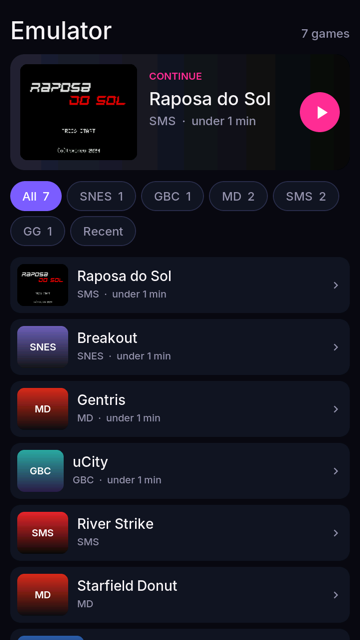
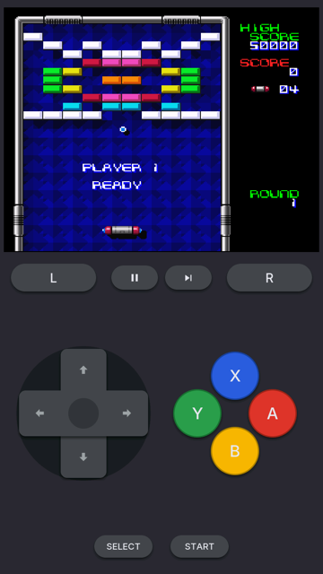
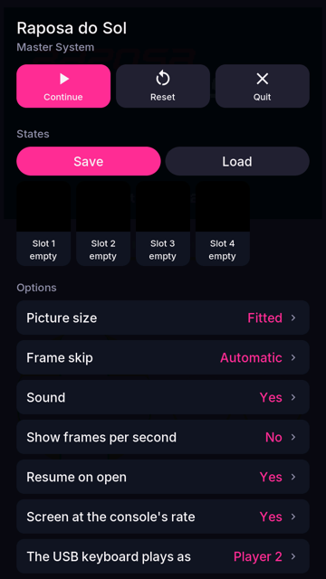
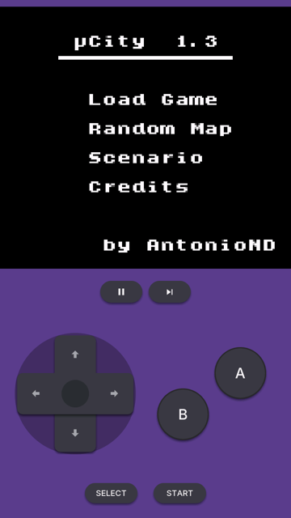
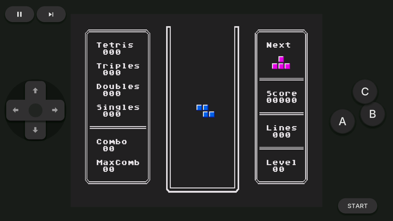

# Emulador

Consoles of other times on the board, from the card: fourteen of them, from
the Atari 2600 to the Neo Geo, each a core behind one small table
(`main/emu_core.h`) and each core a module of its own on the card, loaded
only while one of its games plays. An app of the card (`emulador.so`); what
it takes from the firmware is in the firmware's table since commit
`8bdf0da` (below).

| The library | Super Nintendo | The menu | Game Boy Color |
|---|---|---|---|
|  |  |  |  |



*The simulator, with free homebrew games: Breakout (SNES), uCity (GBC),
Raposa do Sol (SMS) and Gentris (Mega Drive), lying down.*

## On the card

```
/sdcard/emulador/
    ajustes.txt             the app's settings (it rewrites this file)
    recientes.txt           when each game was last played, and for how long
    nes/                    the games of a console (subfolders too, two levels)
        bios/               system files the console may use
        saves/<game>.sav    battery saves: the raw .sav other emulators use
        states/<game>.st0   save states: 0 the automatic one, 1..4 by hand,
        states/<game>.st0.thm   each with the picture it was saved on
    gba/ ...
```

The app makes the folders (with a `LEEME.txt` in each) the first time it
opens. Games may come zipped: a `.zip` in a console's folder is that
console's, and the file inside is inflated once into the folder's hidden
`.cache/` (`main/em_zip.c`). A game asked for in `emulador/abrir.txt`
("<console>/<path>") opens from the library: the portal's "Jugar en la
placa" uses it. Games go in by copying them to the card, over USB disk mode, or from
the **Emulador page of the portal** (`web/emulador.js`): drop the files on
it. The page also shows each game with the picture it was left on, takes and
gives battery saves (to bring a game from another emulator) and the BIOS
files.

| Console | Files | BIOS (in `bios/`) |
|---|---|---|
| NES | `.nes` `.fds` `.nsf` | optional: `disksys.rom` for the Famicom Disk System |
| Game Boy / Color | `.gb` / `.gbc` | — |
| Game Boy Advance | `.gba` `.agb` `.bin` | optional: `gba_bios.bin`; without it gpSP's free replacement BIOS runs |
| Super Nintendo | `.sfc` `.smc` | — (SuperFX, SA-1, S-DD1, SPC7110 games refused) |
| Mega Drive | `.md` `.gen` `.bin` `.smd` | — |
| Master System / Game Gear | `.sms` `.sg` / `.gg` | — |
| ColecoVision | `.col` | required: `coleco.rom` |
| PC Engine | `.pce` | — (HuCards only) |
| Neo Geo | MAME `.zip` sets, by their short name | required: MAME's `neogeo.zip` |
| Atari 2600 / 7800 | `.a26` `.bin` / `.a78` `.bin` | 7800: optional `7800 BIOS (U).rom` |
| Atari Lynx | `.lnx` `.lyx` `.o` | — (the boot ROM is emulated) |

No game or BIOS comes with the app.

## Playing

- **The library:** the last game played on top, with the picture it was
  left on (*Continuar*); the consoles as chips; the games sorted by recent
  or A-Z. A tap plays from where the game was left (its automatic state);
  a long press offers to start from the beginning.
- **Upright** the picture fills the width (GBA x3 = 720x480, NES x2.8125)
  and the console's pad is under it; **lying down** the picture is in the
  middle and the pad's halves are at the thumbs. The board turns without
  stopping the game.
- **The pad on the screen** is the console's own: one fire button for the
  2600, B A side by side for the NES, Master System and PC Engine, B low
  and A high for the Game Boys and the Lynx, the SNES's diamond, three or
  six buttons for the Mega Drive, the Neo Geo's arc of four, and L/R where
  the console has them, each in the console's colours. Up to five fingers
  at once (the d-pad, two buttons and a shoulder): the d-pad follows the
  thumb's angle (eight ways, it keeps it while the thumb slides), and two
  neighbouring buttons are one cluster, so a thumb between them presses
  both.
- **⏸** opens the menu, **⏭** is fast forward (no sound, a third of the
  pictures).
- **The menu:** Continue, Reset, Quit (the automatic state is saved), the
  save states (four slots plus the automatic one, each with its picture)
  and the options: the picture's size (fitted, whole multiples, stretched),
  frame skip, sound, frames a second on screen, resume on open, and the
  console's own (the NES palette, overscan and sprite limit; the GBA's
  BIOS and colour correction; the Neo Geo's system, region and sprite
  cache; the Mega Drive's pad of three or six buttons...), and the GBA's
  recompiler.
- **USB gamepads:** pad 1 is player 1 (together with the screen), pad 2
  player 2 (the NES has two). The buttons as a SNES-style pad numbers them:
  X=1, A=2, B=3, Y=4, L=5, R=6, SELECT=9, START=10, with X/Y doubling as
  A/B on consoles without them. **SELECT+START** held opens the menu, and
  the d-pad + A go through it (B or START closes it).
- Battery saves are written when leaving and every 30 s while playing, if
  the game changed them.

## How it is built

| File | What |
|---|---|
| `main/emulador.c` | the app: life cycle, icon, which screen is up |
| `main/em_lib.c` | the library |
| `main/em_game.c` | the game screen: layout, the pad, gamepads, presenting frames |
| `main/em_menu.c` | the pause menu |
| `main/em_run.c` | the console in the worker (core 0): pacing, frame skip, fast forward, frame slots, commands |
| `main/em_files.c` | the card: folders, games, saves, states, thumbnails, recents, settings, each console's skin |
| `main/emu_cores.c` | the consoles: their stable ids, finding the modules and keeping what they say |
| `main/em_zip.c`, `em_tinfl.c` | zipped games, inflated once to the console's `.cache/` |
| `main/em_strings.c` | the texts the cores show, for the language catalogs |
| `main/emu_core.h` | **the contract with a console's core** |
| `cores/<id>/` | a core: its sources, `board.cmake` and `sim.cmake` |
| `sim.cmake` | the simulator's side (included by `sim/CMakeLists.txt`) |
| `web/emulador.js` | the portal's page |

**Threads.** The console runs in the HAL's worker on core 0 (LVGL is on core
1). The microsecond clock sets each frame's deadline and the speaker's ring
nudges it (an eighth of a frame earlier or later when it runs low or full),
so emulation and sound never drift; with the sound off it is the clock
alone. When a frame runs late the next ones are not
drawn (up to three in a row) so the game keeps its speed. Frames go to the
screen through three slots, as in Doom's and Duke's ports; the LVGL side
blits the newest with the PPA into the panel's free buffer, brings the pad
up to date there from the buffer on screen, and flips.

**A core** is a static library of its own (`cores/emu_cores.cmake`,
`emu_core_board_lib()`), compiled with its own flags (C, C++, assembly,
-O2), then linked into its module `build/modules/<dir>.so`; the app's own
files go through `project_so()`'s -Os. A core exports only its
`emu_core_<id>` tables. In the simulator the cores are linked into the app
(`sim.cmake`). `EMU_ONLY="nes gba"` builds just those.

**Adding a console:** a `cores/<dir>/` with the core, its adapter
implementing `emu_core_t`, `board.cmake` and `sim.cmake` (both globbed; set
`EMU_CORE_IDS` for several consoles in one folder); for the simulator its
id in `main/emu_cores.c`, and a skin in `em_files.c`. The texts it shows
go in `main/em_strings.c` for the catalogs.

**The picture** is scaled by the PPA, whose factor goes in steps of 1/16:
each axis gets an exact step (`fit()` in `em_game.c`). A factor that the
PPA rounds leaves its last column unpainted, the stripe of noise seen at
the picture's right edge before 6fabed1.

**Touch.** The pad reads every finger the GT911 reports
(`aos_touch_points_n`, up to five, firmware ddc159c). A finger that lands
while another rests counts after 30 ms, without waiting for the chip's
next report, which never comes for fingers that do not move.

## Measured on the board

Chip rev 1.3, the panel's clock at 80 MHz (60 Hz). While a game plays the
app logs its frame rates and times, with the core's own numbers (the
recompiler's, the sprite cache's), and the menu's "frames per second"
shows them over the game.

| | |
|---|---|
| Game Boy Advance (Frogger, the recompiler on) | 59.7 fps, 5-7 ms a frame |
| Neo Geo (Metal Slug) | 59 fps, 13-17 ms a frame, 98-99 % of sprite tiles from the cache |
| The fourteen consoles in eleven modules | found in 515 ms the first time, 31 ms after (the catalog) |

The other consoles were played on the board too, with no complaint about
speed, and the pad with the d-pad and two buttons held at once; their frame
times are not written down yet. Two traps found there and fixed: the GBA's recompiler hung the
board with P4 instructions that the rev 1.3 chip lacks or that fault on a
stack in PSRAM (`cores/gba/README.md`); and Neo Geo's sprite cache thrashed
at 1.8 fps until it kept what the frame on screen uses
(`cores/neogeo/README.md`). A Neo Geo game whose automatic state was saved
on an error screen (MVS's "CALENDAR ERROR") keeps showing it: start it from
the beginning (a long press).

## What it takes from the firmware

Since the firmware's commit `8bdf0da` (docs/APPS-P4.md, "Emulators"):

- **Modules:** each core is its own `apps/emulador/<dir>.so` on the card
  (`aos_hal_module_open`), loaded only while one of its consoles plays. The
  app (60 KB) finds them when it opens and keeps what their tables say in
  `emulador/.modulos.txt`, so the library opens none. A module exports
  `emu_module_abi()` and `emu_module_core(i)` (generated from
  `cores/emu_module.c.in`); one built against another `EMU_CORE_ABI` is
  refused. `tools/build_apps.sh` builds and checks them
  (`build/modules/*.so`) and `tools/install_apps.sh` installs them.
- **The GBA's recompiler:** blocks of the PSRAM heap and
  `aos_hal_code_sync` (setting `jit` in the menu, on by default).
- **A player on the keyboard:** `aos_hal_usb_kbd_held`. The arrows, X = A,
  Z = B, S = X, A = Y, Q = L, W = R, Enter = START, Backspace or the right
  Shift = SELECT; Esc opens the menu, Tab held is fast forward. It plays as
  player 2 where the console has two (setting), so one plays on the screen
  and one on the keyboard.
- **The panel at the console's rate** while a game plays
  (`aos_hal_display_refresh_request`): 60 Hz needs the panel's 80 MHz
  clock (`POST /api/panel/qos?mhz=80`, from the next boot); otherwise ~51.

## Third-party code

Each core is its own module and carries its own licence; the app
(`emulador.so`: `main/`, `web/`) is MIT like the rest of the repository.

| Module | Core | Licence |
|---|---|---|
| `nes.so` | nofrendo, as Retro-Go carries it | GPL-2.0 (LGPL-2 headers) |
| `gb.so` | gnuboy, as Retro-Go carries it | GPL-2.0 |
| `gba.so` | gpSP with gpsp-esp32's RV32 recompiler | GPL-2.0-or-later / GPL-3.0-or-later |
| `snes.so` | Snes9x (snes9x2005 line), as Retro-Go carries it | **Snes9x licence, non-commercial** |
| `sms.so` | SMS Plus, with a Z80 and SN76489 written for P4OS | GPL-2.0-or-later |
| `pce.so` | pce-go, as Retro-Go carries it | GPL-2.0 |
| `md.so` | Gwenesis (Musashi 68000, Marat Fayzullin's Z80) | **AGPL-3.0**; the Z80's notice forbids commercial distribution |
| `neogeo.so` | gngeo (Generator 68000), superzazu's z80, MAME's YM2610 | GPL-2.0-or-later; MIT; old MAME files with no licence |
| `a2600.so` | Stella | GPL-2.0-or-later |
| `a7800.so` | ProSystem | GPL-2.0-or-later |
| `lynx.so` | Handy | Handy's licence (permissive) |

The app itself carries miniz's inflate (`third/tinfl.c`, MIT, the VNC
viewer's copy) for zipped games. Every change to a vendored core is listed
in `cores/<dir>/README.md`. No
game or official BIOS comes with any of them.
